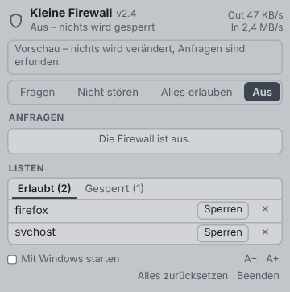

# Kleine Firewall (Windows)

Fragt nach, bevor ein Programm ins Netz darf. Nutzt nur die eingebaute
Windows-Firewall, kein eigener Treiber.

## Herunterladen und installieren

Rechts auf **Releases** klicken und bei der neuesten Version
`KleineFirewall-Setup-<Nummer>.exe` herunterladen und ausfuehren. Danach steht
"Kleine Firewall" im Startmenue. Eine neue Version einfach darueber installieren.
Entfernen: Windows-Einstellungen -> Apps -> Kleine Firewall -> Deinstallieren
(setzt dabei alles zurueck).

Die Setup-Datei ist nicht signiert: Windows zeigt eine Warnung
("Weitere Informationen" -> "Trotzdem ausfuehren").

## Versionen

- **2.7** - Fenster oeffnet sich unten rechts bei der Taskleiste; "Listen leeren" statt "Alles zuruecksetzen": leert beide Listen, gibt alles frei, das Programm bleibt offen (Modus "Aus"); danach wird geprueft und angezeigt, ob Windows wirklich alles freigibt.
- **2.6** - "Alles zuruecksetzen" und "Aus" entfernen wirklich alle Regeln dieser Firewall, auch uebrig gebliebene aus frueheren Versionen.
- **2.5** - eine einzige Setup-Datei statt ZIP-Ordner; eigenes Programmsymbol; Eintrag im Startmenue.
- **2.4** - Schalter "Aus" (Listen bleiben erhalten); nie mehr unbemerkt gesperrt: Freigabe beim Beenden und beim Hochfahren, Sperre nur bei laufendem Programm.
- **2.3** - eigenes Fenster startet auch nach dem Entpacken eines heruntergeladenen ZIP; sonst Anzeige ueber den Browser.
- **2.2** - loest eine noch laufende aeltere Version selbst ab; zeigt eine Meldung statt stumm zu scheitern; schreibt ein Protokoll.
- **2.1** - als Ordner im ZIP statt als einzelne EXE (weniger Fehlalarme bei Virenscannern); jeder Build wird mit Windows Defender geprueft.
- **2.0** - eigenes Programmfenster statt Browser; Schliessen-Kreuz blendet es nur aus, das Programm laeuft in der Taskleiste weiter.
- **1.7** - eigenes kleines Fenster auch auf Rechnern, auf denen Edge anders installiert ist oder fehlt (dann ueber Chrome).
- **1.6** - Versionsnummer im Dateinamen (`KleineFirewall-1.6.exe`); Autostart folgt der neuen Datei.
- **1.5** - Rechtsklick auf das Taskleisten-Symbol zeigt ein Menue mit "Oeffnen" und "Beenden".
- **1.4** - es gibt nur noch ein Fenster; ein offenes wird nach vorn geholt statt neu geoeffnet.
- **1.3** - Fenster oeffnet sich in der richtigen Groesse (war winzig bzw. riesig).
- **1.2** - kleineres, ruhigeres Fenster; Groesse mit A-/A+ einstellbar;
  Fenster passt sich dem Inhalt an; Versionsnummer sichtbar.
- **1.1** - mehr Angaben zu jeder Anfrage (Hersteller, Ziel, Port, Datei).
- **1.0** - erste Version mit Fragen-Modus, Listen und Taskleisten-Anzeige.

## Bedienung

- **Fragen** (Standard): neue Programme erscheinen als Anfrage - Erlauben oder Sperren.
- **Nicht stoeren**: Neues bleibt still gesperrt und wartet als Anfrage.
- **Alles erlauben**: alles darf raus, nur die Sperrliste gilt.
- **Aus**: die Firewall ruht komplett, auch die Sperrliste; die Listen bleiben gespeichert.
- Symbol in der Taskleiste: oben Out, unten In. Klick oeffnet das Fenster.

Gut zu wissen:
- Der erste Verbindungsversuch eines neuen Programms scheitert; nach
  "Erlauben" klappt der naechste.
- Gesperrt wird Unbekanntes nur, solange das Programm laeuft und fragen kann.
  Beim Beenden und bei jedem Hochfahren wird freigegeben; die Sperrliste gilt
  immer. Mit dem Haken "Mit Windows starten" beginnt der Schutz nach der Anmeldung.
- Listen leeren und alles freigeben: Knopf "Listen leeren". Ganz entfernen: deinstallieren oder
  `KleineFirewall.exe --zuruecksetzen`.
- Nur ansehen, ohne etwas zu veraendern: `KleineFirewall.exe --demo`.
